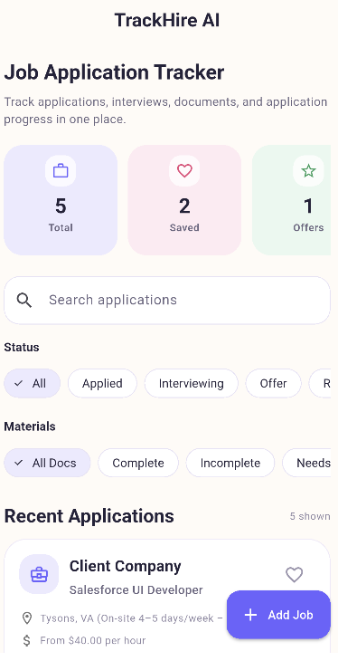
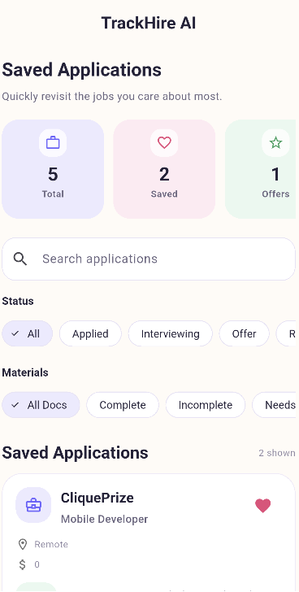
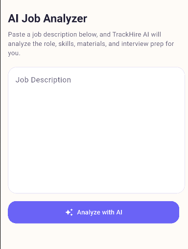
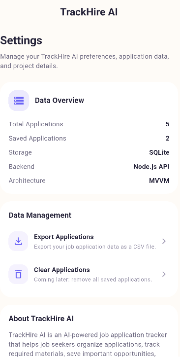

# TrackHire AI


TrackHire AI is a full-stack Flutter application I built to help job seekers organize applications, job descriptions, materials, notes, and interview preparation in one place.

I originally built TrackHire while managing my own internship and new-grad job search. As the project grew, it also became the testbed for a second project: an AI software engineering factory for studying how coding agents can be coordinated, validated, recovered, evaluated, and trusted on real engineering tasks.

The repository therefore contains two related systems:

1. **TrackHire AI**: the user-facing Flutter job-search application.
2. **AI Engineering Factory**: developer infrastructure that analyzes the TrackHire repository, routes engineering tasks, executes AI-generated changes in isolated environments, validates the results, performs bounded recovery, escalates uncertainty, and measures engineering outcomes.

The factory does not make TrackHire autonomous and is not exposed to TrackHire users. TrackHire serves as a real codebase for testing AI-assisted software engineering under deterministic evaluation.

---

## Demo Video

A short walkthrough of the main application tracking flow, saved jobs page, job analyzer, and settings page.

https://github.com/user-attachments/assets/42c91ef6-a733-48a4-aea2-1aaa86538415

---

# TrackHire Product

## Why I Built It

During my own job search, I realized that the hardest part was not just finding jobs. It was keeping track of everything after applying.

Job descriptions were saved in browser tabs, application status lived in spreadsheets, notes were stored elsewhere, and interview preparation was disconnected from the applications themselves.

I wanted one workspace where I could keep that information together.

That became TrackHire AI.

---

## What the App Does

TrackHire supports workflows for:

- Adding and managing job applications
- Tracking application status
- Searching and filtering applications
- Saving important roles
- Tracking resumes, cover letters, portfolios, application questions, and other materials
- Analyzing pasted job descriptions into structured information
- Generating resume-bullet assistance
- Saving job analysis into the main tracker
- Maintaining notes for individual applications
- Viewing application statistics
- Importing and exporting application data with CSV
- Sharing exported files through the native mobile share sheet

The app supports Android and iOS simulator development from the same Flutter codebase.

---

## Screenshots

### Home Screen



### Saved Applications



### Job Analyzer



### Settings



---

## Product Design

I wanted TrackHire to feel like a workspace rather than another list of companies.

The application list is the center of the experience. From there, users can search, filter, save important roles, inspect application details, maintain notes, and track the materials associated with each application.

The job analyzer is connected to the same workflow. A user can paste a job description, receive a structured breakdown, and save useful information into the tracker instead of treating the analysis as a separate one-time tool.

The goal was to reduce the amount of context switching required during a job search.

---

## Technical Architecture

The mobile application is built with Flutter and Dart.

Provider manages application state, while the project follows MVVM-inspired separation between models, services, viewmodels, screens, and reusable widgets.

TrackHire also includes a Node.js and Express backend with SQLite persistence. The frontend communicates with the backend through REST APIs and JSON serialization.

```text
Flutter UI
    ↓
Provider State Management
    ↓
ViewModel Layer
    ↓
Service Layer
    ↓
API / Analysis Services
    ↓
Node.js + Express REST API
    ↓
SQLite
```

One important design principle is that UI state should not claim a change succeeded before the underlying persistence operation succeeds. This keeps the backend/persistence layer as the source of truth for confirmed changes.

---

## Job Analysis

TrackHire includes a structured job-description analysis workflow.

A pasted job description can be converted into information such as:

- Company
- Role title
- Location
- Salary range
- Required skills
- Preferred skills
- Recommended application materials
- Interview preparation questions
- Role summary

The original TrackHire analysis workflow was implemented locally and deterministically rather than through a production LLM API.

That distinction became important later when I started building the engineering factory. The factory uses actual model providers and structured model interactions, while the TrackHire product itself remains a separate user-facing system.

---

# AI Engineering Factory

## Why I Built It

While building TrackHire, I increasingly used tools such as ChatGPT, Cursor, and Codex to reason about unfamiliar code, debug problems, and make repository-level changes.

That raised a more interesting engineering question:

> If an AI system can generate a plausible code change, what evidence should be required before that change is trusted?

A coding model producing code is only one part of the problem.

Real engineering work also requires understanding an existing repository, identifying affected files, reasoning about risk, coordinating changes across components, validating behavior, diagnosing failures, deciding when another attempt is justified, and knowing when a human should take over.

I built the AI Engineering Factory to experiment with those problems directly.

---

## Factory Mission

The factory is designed to coordinate AI-assisted engineering work while keeping execution measurable, controllable, and verifiable.

Given an engineering task, the system can:

- Build context from an existing repository
- Analyze task complexity and risk
- Identify relevant files and affected areas
- Generate structured implementation plans
- Select an execution strategy
- Run work in isolated Git worktrees
- Validate generated changes deterministically
- Diagnose failures
- Perform bounded repair attempts
- Escalate ambiguous or low-confidence failures
- Support human approval gates
- Collect evidence connecting requirements, implementation, and validation
- Measure success, latency, model usage, retries, cost, and human intervention

The objective is not maximum autonomy.

The objective is understanding when additional AI orchestration actually improves software engineering outcomes.

---

## Factory Workflow

```text
Engineering Task
       ↓
Repository Intelligence
       ↓
Complexity + Risk Analysis
       ↓
Planning
       ↓
Human Plan Approval
       ↓
Execution Strategy
       ↓
Isolated Implementation
       ↓
Deterministic Validation
      ↙               ↘
   Passed             Failed
      ↓                  ↓
   Review             Diagnosis
      ↓                  ↓
Final Human       Repairable?
  Approval          ↙       ↘
                  Yes        No / Uncertain
                   ↓              ↓
             Bounded Repair   Human Escalation
                   ↓
              Revalidation
```

---

## Adaptive Execution

The factory separates orchestration from model behavior.

Tasks can be routed into different execution modes depending on complexity and risk.

### Lightweight

A small task can use a direct implementation path:

```text
Task → Implementation → Validation
```

### Sequential

More involved tasks can use explicit planning, implementation, validation, diagnosis, and bounded recovery:

```text
Task
  ↓
Plan
  ↓
Implementation
  ↓
Validation
  ↓
Diagnosis / Repair when necessary
  ↓
Review
```

### Parallel

The architecture also supports decomposition into independent work when the task graph makes parallel execution appropriate.

Parallelism is treated as an engineering decision rather than an assumption that more agents are automatically better.

---

## Isolation

AI-generated engineering changes are executed in isolated Git worktrees.

This allows an agent to modify and validate a real repository without directly changing the primary working tree.

Isolation also makes experiments reproducible because each benchmark run starts from a known repository revision.

---

## Deterministic Validation

The factory does not treat a model's explanation of its own work as proof that the work is correct.

Generated changes can be checked with deterministic tools such as:

- Static analysis
- Automated tests
- Build commands
- Repository-specific validation
- Protected acceptance fixtures
- Regression tests

A task is not considered successful simply because the generated code looks reasonable.

---

## Failure Diagnosis and Bounded Recovery

When deterministic validation fails, the factory can classify the failure and decide whether automated recovery is appropriate.

Failure categories include:

- `STATIC_ANALYSIS`
- `TEST_REGRESSION`
- `INCORRECT_IMPLEMENTATION`
- `INTEGRATION_MISMATCH`
- `ENVIRONMENT`
- `REQUIREMENT_AMBIGUITY`
- `UNKNOWN`

A diagnosis also contains evidence, suspected files, a recommended action, confidence, repairability, and whether human input is required.

Repair attempts are bounded.

The system does not retry indefinitely.

If confidence is too low, requirements are ambiguous, or the failure is not safely repairable, the task can transition to human escalation instead.

---

## Human Approval

Human oversight is part of the state machine rather than an informal fallback.

Important gates include:

- Plan approval
- Approval before sensitive parallel execution
- Final approval before accepting completed work

The factory is designed around the idea that increased automation should come with stronger evidence, not weaker review.

---

## Model Layer

The factory uses a provider abstraction so orchestration logic is not tied to one model vendor.

The model layer supports structured requests and responses while allowing different providers to be evaluated behind the same contract.

The project includes support for local Ollama inference and provider abstractions for additional model stacks.

For local evaluation, I used:

`qwen2.5-coder:7b`

through Ollama.

This allowed real model experiments without API cost while also exposing an important operational tradeoff: local inference can have significant latency and compute cost even when monetary cost is zero.

---

# Evaluation and Benchmarks

Building the orchestration system was only part of the project.

I also built an evaluation layer to measure whether the factory actually improves engineering outcomes.

The benchmark infrastructure records measurements including:

- Overall task success
- Deterministic validation
- Acceptance-criteria success
- Individual criterion success
- Runtime
- Input tokens
- Output tokens
- Estimated model cost
- Human intervention

Each run uses an isolated workspace and a known repository baseline.

Protected acceptance fixtures are installed after implementation so the coding path cannot simply modify the benchmark to make itself pass.

---

## Benchmark Scenario 1: Interview Scheduling

The first real TrackHire benchmark asked the model to add optional interview scheduling.

The feature required:

- Optional interview dates
- Persistence through serialization
- Editing existing dates
- Upcoming-interview derivation
- Filtering missing and past dates
- Preservation of existing behavior

### Baseline

Untouched TrackHire:

- Feature criteria: **0 / 4**
- Regression: **PASS**

This confirmed that the benchmark detected the missing feature while recognizing that the existing application was healthy.

### Real Qwen One-Shot Run

Model:

`qwen2.5-coder:7b`

Result:

- Overall success: **FAIL**
- Deterministic validation: **FAIL**
- Acceptance criteria: **0 / 5**
- Runtime: **338.6 seconds**
- Input tokens: **5,436**
- Output tokens: **5,187**
- Estimated API cost: **$0**

The model identified the general feature and affected areas but produced type, nullability, date-representation, and filtering errors.

The generated change also caused regression validation to fail.

---

## Benchmark Scenario 2: Application Status Summary

The second benchmark tested a different engineering behavior.

The task asked the model to add a summary counting applications in every supported status.

The implementation needed to:

- Count applications by status
- Return zero for empty statuses
- Update when the application collection changes
- Represent all supported statuses
- Preserve existing behavior

### Baseline

Untouched TrackHire:

- Feature criteria: **0 / 4**
- Regression: **PASS**

### Real Qwen One-Shot Run

Result:

- Overall success: **FAIL**
- Deterministic validation: **FAIL**
- Acceptance criteria: **0 / 5**
- Runtime: **189.3 seconds**
- Input tokens: **3,775**
- Output tokens: **3,270**
- Estimated API cost: **$0**

The generated production code was directionally reasonable, but the model failed to maintain consistency across the repository.

The generated tests:

- Called an API on `JobApplication` even though the model implemented it on `ApplicationProvider`
- Constructed `JobApplication` objects without required constructor arguments
- Used `Offered` while the implementation used `Offer`

Flutter analysis reported **61 issues**.

This was useful because the model broadly understood the requested feature while still producing repository-inconsistent engineering work.

---

## Controlled Recovery Experiment

Real local-model recovery can require several expensive model calls, so I separated orchestration correctness from model quality.

Using deterministic model providers, I tested the actual diagnosis and repair workflow:

```text
Initial Implementation
       ↓
Validation FAIL
       ↓
Diagnosis
       ↓
Repair
       ↓
Validation PASS
```

The experiment verified that the factory could:

- Detect a failed implementation
- Produce a structured diagnosis
- Determine that the failure was repairable
- Enter the repair state
- Apply a bounded repair
- Revalidate the repository
- Continue after validation passed

This verifies the recovery architecture independently from Qwen's ability to perform the repair.

---

## Controlled Human-Escalation Experiment

I also tested the opposite case.

A controlled diagnosis reported:

- Requirement ambiguity
- Low confidence
- Not safely repairable
- Human input required

The factory correctly:

- Diagnosed the failure
- Refused to run the repair path
- Transitioned to `NEEDS_HUMAN`
- Preserved the workspace without applying the configured unsafe change

This verifies that escalation is an explicit orchestration behavior rather than a manual exception.

---

## What the Experiments Showed

The current experiments support several conclusions.

### Plausible code is not enough

Both real Qwen runs produced changes related to the requested feature.

Both still failed deterministic verification.

### Repository consistency is a major failure surface

A model can understand a feature at a high level while using the wrong API, violating an existing constructor contract, or generating inconsistent changes across files.

### Regression tests matter

Both untouched baselines passed regression validation.

Both real one-shot implementations caused regression validation to fail.

That distinction allows the benchmark to separate "the requested feature does not exist yet" from "the generated change broke something."

### Recovery and escalation can be tested independently from model quality

Deterministic providers make it possible to verify orchestration behavior in seconds without repeatedly invoking a slow local model.

### Local models still have operational cost

The completed real-model runs took approximately:

- **338.6 seconds** for interview scheduling
- **189.3 seconds** for status summary

A multi-call real recovery experiment was stopped after approximately three hours.

Even with zero API cost, latency and local compute consumption are still engineering costs.

---

## What the Experiments Do Not Show

The current evidence does **not** establish that:

- Qwen cannot complete these tasks under a different configuration
- Sequential orchestration outperforms lightweight execution
- Real-model bounded recovery improves task success
- Multi-agent execution is better than single-agent execution
- Parallel execution improves outcomes
- Other models would fail in the same way
- Two TrackHire tasks represent software engineering generally

I intentionally keep these claims separate from what the experiments actually demonstrated.

The goal of the evaluation layer is to make those distinctions measurable rather than assume that more agents or more model calls automatically produce better engineering.

For the detailed experiment log, see [`factory/EXPERIMENTS.md`](factory/EXPERIMENTS.md).

---

# Factory Source Structure

```text
factory/
├── src/
│   ├── agents/          # Planning, implementation, review, diagnosis, repair
│   ├── artifact/        # Engineering artifacts and outputs
│   ├── benchmarks/      # TrackHire benchmark scenarios and experiment runners
│   ├── context/         # Repository context and intelligence
│   ├── evaluation/      # Evaluation infrastructure
│   ├── evidence/        # Requirement and validation evidence
│   ├── github/          # GitHub integration
│   ├── models/          # Model provider abstractions and implementations
│   ├── orchestrator/    # Task routing and state-machine orchestration
│   ├── runtime/         # Execution runtime and isolation
│   ├── schemas/         # Structured task, plan, analysis, and result schemas
│   ├── tools/           # Engineering tools
│   └── validation/      # Deterministic validation
├── EXPERIMENTS.md
└── package.json
```

---

# Technology

## TrackHire

- Flutter
- Dart
- Material 3
- Provider
- Node.js
- Express.js
- SQLite
- REST APIs
- JSON serialization
- CSV import/export
- `share_plus`
- `path_provider`

## AI Engineering Factory

- TypeScript
- Node.js
- Zod
- Vitest
- Ollama
- Qwen2.5-Coder
- Structured model outputs
- Git worktrees
- Deterministic validation
- State-machine orchestration
- Failure classification
- Bounded recovery
- Human-in-the-loop approval
- Benchmark evaluation
- Model usage and latency measurement

## Tooling

- Git
- GitHub
- GitHub Actions
- Flutter Analyze
- Flutter Test
- TypeScript
- Vitest
- Android APK builds
- Xcode iOS Simulator

---

# Repository Structure

```text
TrackHire-AI/
├── lib/
│   ├── models/
│   ├── providers/
│   ├── services/
│   ├── viewmodels/
│   ├── screens/
│   ├── widgets/
│   ├── database/
│   └── main.dart
│
├── backend/
│   ├── routes/
│   ├── server.js
│   └── package.json
│
├── factory/
│   ├── src/
│   ├── EXPERIMENTS.md
│   └── package.json
│
├── screenshots/
└── README.md
```

---

# CI/CD

TrackHire uses GitHub Actions to check:

- Dart formatting
- Flutter static analysis
- Flutter tests
- Android debug APK builds

The factory also has its own TypeScript and Vitest verification suite.

At the completion of the current factory implementation and evaluation work, the factory test suite contains **704 passing tests**.

---

# What I Learned

TrackHire started as a mobile product project, but it ended up teaching me about two different sides of software engineering.

On the product side, I learned how to structure a larger Flutter application, manage shared state, connect a mobile frontend to a REST backend, persist data, design workflows around a real user problem, and build CI around a cross-platform application.

The factory pushed me into a different set of problems.

I learned that building with coding models is much less about whether a model can produce code and much more about what happens around that model.

Some of the most important lessons were:

- Repository context matters as much as the task prompt
- Generated code needs independent validation
- Cross-file consistency is easy for models to lose
- Recovery should be bounded rather than infinite
- Confidence should influence whether automation continues
- Human escalation should be designed into the workflow
- Strategy labels are meaningless unless execution behavior actually changes
- More model calls can increase latency without improving outcomes
- Negative experiments are still useful engineering evidence
- Evaluation needs to separate orchestration quality from model quality

The biggest shift in how I think about AI engineering is that model output is not the final artifact.

The real artifact is a change supported by enough evidence to justify trusting it.

---

# Next Steps

For the TrackHire product, future work could include:

- Authentication
- Cloud synchronization
- Resume parsing
- Interview scheduling and reminders
- Application analytics
- Multi-device support
- Production mobile distribution
- User testing and feedback

For the factory, the next useful research question is not simply adding more agents.

It is determining when additional orchestration improves engineering outcomes enough to justify the additional model calls, latency, and complexity.

Future evaluation could compare genuinely different execution strategies across more engineering tasks and model configurations while keeping repository baselines, acceptance criteria, and validation controlled.

---

# APK

Android APK:

https://drive.google.com/file/d/1o03Y8E9fmwhhF-GbZhPGtK1KeHRM7P0s/view?usp=sharing

---

# Author

Selena Zhang

GitHub: https://github.com/szzbj720